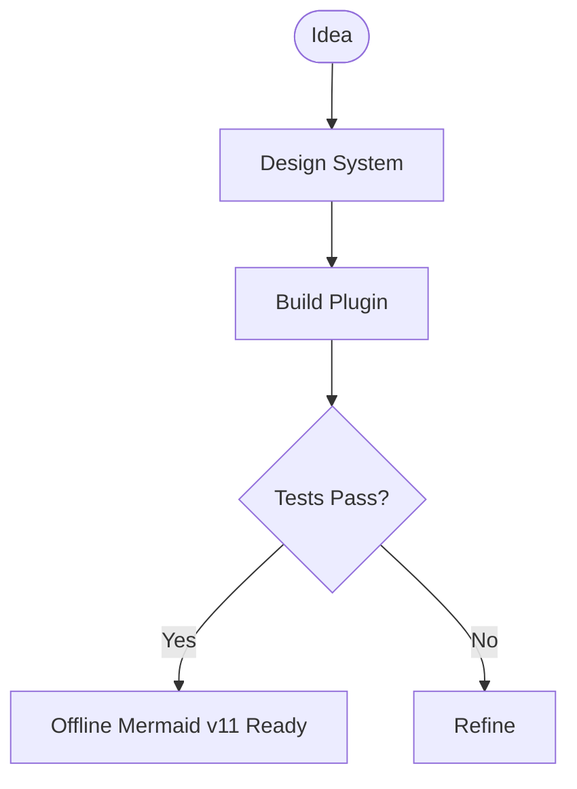

# Mermaid for TiddlyWiki5 (`$:/plugins/mblackman/mermaid`)

Modern, self-contained, 100% offline **Mermaid.js (v11+)** diagram rendering plugin for TiddlyWiki5 (`>=5.3.0`).

🔗 **Interactive Live Demo:** [https://mblackman.github.io/tiddlywiki-mermaid/](https://mblackman.github.io/tiddlywiki-mermaid/)

## Installation

### Drag & Drop (Recommended)

1. Open the [Live Demo](https://mblackman.github.io/tiddlywiki-mermaid/) or download `mermaid-plugin.json` / `mermaid.tid` from the [Latest Release](https://github.com/mblackman/tiddlywiki-mermaid/releases/latest).
2. Drag and drop the downloaded file (or the plugin pill from the demo wiki) directly into your TiddlyWiki browser tab.
3. Click **Import** and save/reload your wiki.

## Features

- **100% Offline Execution:** Bundles Mermaid v11+ with all diagram chunks inlined into a single library tiddler. Zero external CDN calls or network requests.
- **Unified WikiText & Markdown Support:** Seamlessly renders fenced code blocks (```` ```mermaid ````) in both native WikiText and Markdown notes (`$:/plugins/tiddlywiki/markdown` / `text/x-markdown`).
- **Direct `<$mermaid>` Widget:** Embed diagrams anywhere via `<$mermaid text="..." />` or inline body `<$mermaid>...</$mermaid>`.
- **Modern Mermaid v11 Grammars:** Full support for Flowcharts, Sequence Diagrams, Class Diagrams, State Diagrams, ER Diagrams, Mindmaps, Timelines, GitGraphs, Pie Charts, Quadrants, XY Charts, Kanban, Architecture Diagrams, C4, Sankey, Packet, Block, and more.
- **Palette-Aware Auto Theming:** Automatically detects light and dark TiddlyWiki palettes (including Slipstream and custom themes) and selects Mermaid's matching theme.
- **Sequential Async Render Queue:** Guards against concurrent rendering collisions and rapid keystroke race conditions.
- **Suite Design System Compliance:** Built with the 3-Tier CSS Token architecture (`MASTER.md`) and `--suite-*` / `--mm-*` tokens.

## Quick Start

### WikiText & Markdown Fenced Blocks

````markdown

````

### Direct Widget

```html
<$mermaid text="sequenceDiagram; Alice->>Bob: Hello;"/>
```

Or with inline body:

```html
<$mermaid>
mindmap
  root((TiddlyWiki))
    Plugins
      Mermaid
      Slipstream
      Projectify
</$mermaid>
```

## Development Commands

```bash
# Install dependencies
npm install

# Bundle Mermaid v11 into single-file CommonJS module
npm run build:mermaid

# Run automated test suite (23 tests: unit, DOM rendering, and TW integration)
npm test

# Build drag-and-drop plugin bundle and demo HTML in dist/
npm run build-all

# Start local dev server
npm run dev
```

## License

MIT © Matt Blackman
